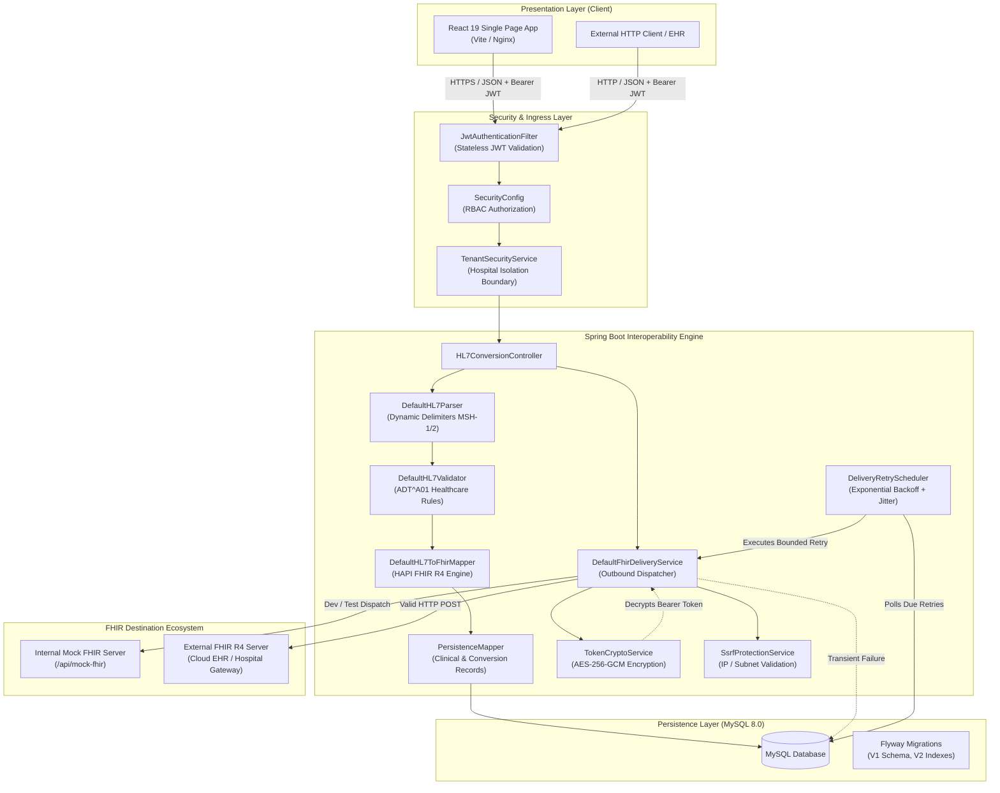
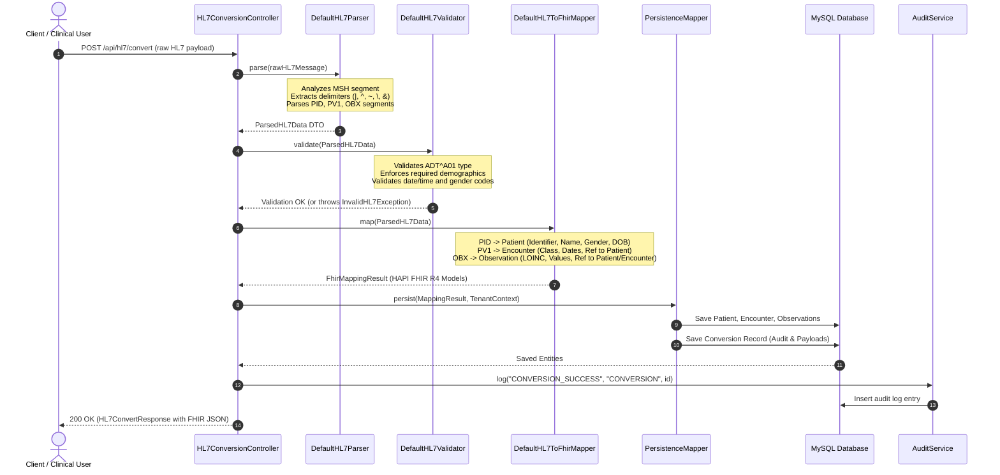

# Healthcare Interoperability Engine

[](https://www.oracle.com/java/)
[](https://spring.io/projects/spring-boot)
[](https://hapifhir.io/)
[](https://react.dev/)
[](https://vitejs.dev/)
[](https://www.mysql.com/)
[](https://flywaydb.org/)
[](https://www.docker.com/)

A full-stack, enterprise-grade healthcare interoperability application designed to ingest legacy HL7 v2 clinical messages, validate message structures against strict healthcare standards, transform them into standard FHIR R4 resources, persist auditable records across isolated hospital tenants, and dispatch FHIR payloads to external endpoints with resilient retry management.

---

## Table of Contents

- [1. Project Description](#1-project-description)
- [2. Problem Statement and Motivation](#2-problem-statement-and-motivation)
- [3. Key Features Verified in Source Code](#3-key-features-verified-in-source-code)
- [4. Technology Stack](#4-technology-stack)
- [5. Architecture and System Design](#5-architecture-and-system-design)
- [6. HL7 v2 to FHIR Conversion Workflow](#6-hl7-v2-to-fhir-conversion-workflow)
- [7. Authentication, Authorization, and Hospital Tenant Isolation](#7-authentication-authorization-and-hospital-tenant-isolation)
- [8. Audit Logs, Destination Management, and Retry Handling](#8-audit-logs-destination-management-and-retry-handling)
- [9. Repository Structure](#9-repository-structure)
- [10. Prerequisites](#10-prerequisites)
- [11. Local Setup Instructions](#11-local-setup-instructions)
- [12. Environment Variable Configuration](#12-environment-variable-configuration)
- [13. Database Setup and Migrations](#13-database-setup-and-migrations)
- [14. Docker Compose Setup](#14-docker-compose-setup)
- [15. API Overview](#15-api-overview)
- [16. Running Automated Tests](#16-running-automated-tests)
- [17. Security Notes and Production Hardening](#17-security-notes-and-production-hardening)
- [18. Future Improvements](#18-future-improvements)
- [19. Author](#19-author)

---

## 1. Project Description

The **Healthcare Interoperability Engine** is a healthcare integration platform developed with Java 17, Spring Boot 3.3.4, React 19, and MySQL 8.0. It bridges the technological divide between legacy hospital information systems (HIS/EMR) communicating via HL7 v2 pipe-delimited standards and modern healthcare platforms operating on the HL7 FHIR (Fast Healthcare Interoperability Resources) R4 JSON standard.

The platform includes:
- A high-throughput transformation backend featuring a custom delimiter-aware HL7 parser and HAPI FHIR R4 object mappers.
- A multi-tenant architecture enforcing strict data isolation between hospital organizations.
- An outbound FHIR delivery pipeline with Server-Side Request Forgery (SSRF) protection and background scheduled retry policies using exponential backoff with jitter.
- An interactive single-page web console (React 19, Vite) for operational monitoring, real-time message transformation testing, destination administration, clinical record inspection, user access management, and HIPAA-conscious audit exploration.

---

## 2. Problem Statement and Motivation

Modern healthcare ecosystems require real-time, interoperable data exchange across electronic health records (EHRs), lab information systems (LIS), public health registries, and cloud analytics platforms. While the healthcare industry has standardized on HL7 FHIR R4 for modern integrations, decades of clinical infrastructure continue to run on legacy HL7 v2 standards designed in the late 1980s.

Deploying point-to-point transformations often introduces severe operational risks:
1. **Data Corruption & Non-standard Delimiters:** Variations in custom delimiters or malformed segments can cause silent mapping failures.
2. **Lack of Tenant Boundaries:** Multi-hospital networks require strict data segregation to comply with data privacy regulations (e.g., HIPAA).
3. **Insecure Credential Storage:** Outbound FHIR destinations frequently require authentication tokens that are stored in plaintext in integration databases.
4. **Transient Delivery Failures:** Destination server downtime or rate limiting results in lost clinical messages without bounded, deterministic retries.
5. **Absence of Auditability:** Missing chronological access and transformation trails prevents compliance verification.

The Healthcare Interoperability Engine solves these challenges through a unified, auditable, and resilient service pipeline that validates, converts, stores, and delivers clinical messages securely.

---

## 3. Key Features Verified in Source Code

The following capabilities are implemented and verified directly within the repository codebase:

- **HL7 v2 Message Parsing & Validation:**
  - Delimiter-aware parser (`DefaultHL7Parser`) that reads delimiters dynamically from `MSH-1` and `MSH-2` (`|^~\&`).
  - Strict validator (`DefaultHL7Validator`) validating `ADT^A01` messages, required demographic fields (`PID-3` identifier, `PID-5` family/given name), strict date formatting (`yyyyMMdd`, `yyyyMMddHHmm`, `yyyyMMddHHmmss`), gender sets (`M`, `F`, `O`, `U`), encounter classes (`I`, `O`, `E`), and observation data types (`NM`, `ST`).
- **HAPI FHIR R4 Resource Mapping:**
  - Maps `PID` segments to standard FHIR `Patient` resources.
  - Maps `PV1` segments to FHIR `Encounter` resources with reference linking to the associated patient.
  - Maps repetitive `OBX` segments to FHIR `Observation` resources with code system mappings (e.g., LOINC) and numeric/string value components.
  - Generates FHIR R4 JSON payloads conforming to standard specifications using HAPI FHIR contexts.
- **Multi-Tenant Hospital Isolation:**
  - Tenant context resolved directly from authenticated user identity via `TenantSecurityService`.
  - Database-enforced foreign key relationships (`hospital_id`) across users, clinical patients, encounters, observations, destinations, and audit logs.
  - Cross-tenant access attempts are rejected with `403 Forbidden` (`TenantAccessDeniedException`).
- **Destination Management & SSRF Protection:**
  - Create, view, update, toggle status, and delete external FHIR destination configurations.
  - `SsrfProtectionService` actively validates destination URLs, rejecting localhost, loopback addresses, private RFC-1918 subnets (`10.0.0.0/8`, `172.16.0.0/12`, `192.168.0.0/16`), and non-HTTP/HTTPS schemes.
  - Live metadata connection tester (`/api/destinations/{id}/test`) querying `{baseUrl}/metadata` without sending clinical data.
- **At-Rest Destination Credential Encryption:**
  - `TokenCryptoService` encrypts destination bearer tokens using authenticated AES-256-GCM with randomized initialization vectors (IV).
  - Enforced key separation: strictly prohibits reusing the `JWT_SECRET` as the `TOKEN_ENCRYPTION_KEY`.
- **Resilient Delivery & Scheduled Retry Queue:**
  - Outbound dispatching of FHIR resources via HTTP POST.
  - `RetryPolicyService` classifies transient vs. permanent HTTP errors (transient: 429, 500, 502, 503, 504, connection timeouts; permanent: 400, 401, 403, 404, 422).
  - Background worker (`DeliveryRetryScheduler`) polls due retries every 5 seconds, using atomic record claiming to eliminate worker race conditions.
  - Calculates exponential backoff with randomized jitter and respects remote `Retry-After` headers.
- **Audit Logging System:**
  - Comprehensive audit trail recording user actions (`LOGIN_SUCCESS`, `CONVERSION_SUCCESS`, `DESTINATION_CREATE`, `FHIR_DELIVERY_SUCCESS`, etc.).
  - Searchable, paginated audit log queries filtered by action, outcome, resource type, hospital ID, and date range.
- **Mock FHIR Test Server:**
  - Internal endpoint (`/api/mock-fhir`) with HAPI FHIR validation and in-memory tracking buffer for local development and destination testing without third-party dependencies.
- **Interactive Web Interface:**
  - Live KPI Dashboard with success rates, resource counters, and recent activity streams.
  - Real-time HL7 Convert Studio with sample message presets and side-by-side FHIR JSON preview.
  - Conversion History viewer, Clinical Records explorer, Hospital Tenant manager, and User Management interface with role assignment.

---

## 4. Technology Stack

### Backend
| Component | Technology | Version | Description |
|---|---|---|---|
| **Runtime** | Java OpenJDK | 17 | LTS Java runtime |
| **Framework** | Spring Boot | 3.3.4 | Core REST API, DI, Data JPA, Security |
| **FHIR Engine** | HAPI FHIR Structures R4 | 7.4.0 | FHIR R4 object models, serialization |
| **Security** | JJWT | 0.12.6 | HMAC-SHA256 JWT creation and parsing |
| **Cryptography** | Java Cryptography Extension | Native | AES-256-GCM authenticated encryption |
| **Database** | MySQL | 8.0 | Relational storage for tenants, clinical data, and logs |
| **Migrations** | Flyway | 10.x | Version-controlled schema migrations (`flyway-mysql`) |
| **Testing** | JUnit 5 & Mockito | Latest Boot | Unit and integration test suites (H2 MySQL mode) |
| **Build Tool** | Apache Maven | 3.9+ | Dependency and packaging lifecycle |

### Frontend
| Component | Technology | Version | Description |
|---|---|---|---|
| **UI Library** | React | 19.2.8 | Declarative single-page user interface |
| **Build System** | Vite | 8.3.0 | Modern ESM frontend bundler and dev server |
| **Routing** | React Router DOM | 7.18.4 | Client-side routing with authentication guards |
| **HTTP Client** | Axios | 1.20.0 | REST client with interceptors for JWT Bearer headers |
| **Styling** | Vanilla CSS3 | Standard | Custom CSS design system, dark-accent theme |
| **Testing** | Vitest & React Testing Library | 5.0.4 / 16.3.3 | Frontend component and route testing |
| **Linter** | Oxlint | 1.81.0 | Fast JavaScript/JSX static analysis |

### Infrastructure
| Component | Technology | Description |
|---|---|---|
| **Containerization** | Docker & Docker Compose | Multi-stage container builds for backend, frontend, and DB |
| **Web Server** | Nginx Alpine | Production reverse proxy serving React static bundle |
| **Base Images** | Eclipse Temurin 17 JRE, Node 20 Alpine | Hardened minimal container images |

---

## 5. Architecture and System Design

The application follows a clean layered architecture with separation of concerns between presentation, orchestration, domain business logic, data persistence, and outbound integration.

### High-Level System Flow



---

## 6. HL7 v2 to FHIR Conversion Workflow

The conversion process executes deterministically through the following verified pipeline:



### Supported Segment Mappings (ADT^A01)

| HL7 v2 Source Field | Target FHIR R4 Attribute | Target Database Column | Notes |
|---|---|---|---|
| `MSH-10` | N/A | `conversions.message_control_id` | Message tracking identifier |
| `MSH-9` | N/A | `conversions.message_type` | Validated: `ADT^A01` |
| `PID-3` | `Patient.identifier`, `Patient.id` | `patients.patient_identifier` | Unique patient medical record number |
| `PID-5.1` / `PID-5.2` | `Patient.name.family` / `.given` | `patients.family_name` / `given_name` | Patient full legal name |
| `PID-7` | `Patient.birthDate` | `patients.birth_date` | Formats: `yyyyMMdd`, `yyyyMMddHHmm` |
| `PID-8` | `Patient.gender` | `patients.gender` | Mapped to administrative gender code |
| `PID-11` | `Patient.address` | `patients.address_line`, `city`, `state`, `postal_code` | Street, city, state, postal code |
| `PID-13` | `Patient.telecom` | `patients.phone_number` | Patient primary telephone contact |
| `PV1-19` | `Encounter.identifier` | `encounters.encounter_identifier` | Visit account or visit number |
| `PV1-2` | `Encounter.class` | `encounters.patient_class` | Mapped via ActCode: `I` (IMP), `O` (AMB), `E` (EMER) |
| `PV1-3` | `Encounter.location` | `encounters.location` | Assigned patient location / ward |
| `PV1-44` / `PV1-45` | `Encounter.period.start` / `.end` | `encounters.admit_date_time` / `discharge_date_time` | Admission and discharge timestamps |
| `PV1-7` | `Encounter.participant` | `encounters.attending_doctor` | Attending physician identifier/name |
| `OBX-3` | `Observation.code` | `observations.observation_code` | Test identifier / LOINC coding |
| `OBX-2` | N/A | `observations.value_type` | Supported: `NM` (Numeric), `ST` (String) |
| `OBX-5` | `Observation.valueQuantity` / `valueString` | `observations.value_numeric` / `value_string` | Numeric quantity or text result |
| `OBX-6` | `Observation.valueQuantity.unit` | `observations.units` | Clinical measurement unit |
| `OBX-7` | `Observation.referenceRange` | `observations.reference_range` | Normal physiological range |
| `OBX-8` | `Observation.interpretation` | `observations.abnormal_flags` | High, low, or abnormal flags |
| `OBX-11` | `Observation.status` | `observations.status` | Mapped to FHIR status (`F` -> Final, `P` -> Preliminary) |

---

## 7. Authentication, Authorization, and Hospital Tenant Isolation

### Authentication Flow
1. **Login:** Clients submit credentials to `POST /api/auth/login`.
2. **Password Verification:** Passwords are verified against stored BCrypt hashes (`BCryptPasswordEncoder`).
3. **Stateless JWT Generation:** Upon successful authentication, a compact, signed JWT token is issued containing:
   - `sub`: Username
   - `role`: Role (`ROLE_ADMIN` or `ROLE_USER`)
   - `hospitalId`: Tenant identifier (or `null` for platform administrators)
   - `exp`: Expiration timestamp (default: 24 hours / 86,400,000 ms)
4. **Token Security:** Tokens contain minimal operational metadata and **never** embed Protected Health Information (PHI).

### Role-Based Access Control (RBAC)
- **`ROLE_ADMIN`:** Full administrative access, including registering new hospitals, creating and managing user accounts across hospital boundaries, and managing platform-wide destinations.
- **`ROLE_USER`:** Operational access for hospital personnel (physicians, nurses, integration specialists). Restricted strictly to conversions, clinical data, destination tests, and deliveries associated with their assigned hospital tenant.

### Hospital Tenant Isolation Matrix

Tenant boundaries are enforced at the database layer through `TenantSecurityService`:

| Resource | Platform Administrator (`hospitalId = null`) | Hospital User (`hospitalId = X`) |
|---|---|---|
| **Conversions** | View all conversions across all hospitals | View and initiate conversions only for Hospital X |
| **Clinical Records** | View all patients, encounters, observations | Access only records where `hospital_id = X` |
| **Destinations** | Manage platform-wide and hospital-specific destinations | Access Hospital X destinations + platform-wide destinations |
| **Deliveries** | Monitor and trigger retries across all hospitals | Monitor and retry deliveries only for Hospital X |
| **Audit Logs** | Query all logs or filter by any hospital | View only logs belonging to Hospital X |
| **User Accounts** | Create and edit users across all hospitals | No user management access (requires `ROLE_ADMIN`) |

---

## 8. Audit Logs, Destination Management, and Retry Handling

### HIPAA-Conscious Audit Trail
Every security-relevant operation is recorded in the `audit_logs` table via `AuditService`:
- **Captured Attributes:** `id`, `actor_id`, `username`, `action`, `resource_type`, `resource_id`, `outcome` (`SUCCESS` / `FAILURE`), `details`, `hospital_id`, `timestamp`.
- **Sanitization:** Passwords, private keys, and unmasked patient clinical records are excluded from audit records.
- **API Capabilities:** Paginated search supporting multiple filter dimensions and date bounds.

### Destination Management & SSRF Hardening
- Destination configurations specify `name`, `baseUrl`, `fhirVersion` (default: `R4`), and `authType` (`NONE` or `BEARER_TOKEN`).
- Destination tokens are encrypted at rest with AES-256-GCM using `TOKEN_ENCRYPTION_KEY`.
- `SsrfProtectionService` prevents attacks against internal cloud infrastructure:
  - Rejects `localhost`, `127.0.0.1`, `::1`.
  - Rejects private IP ranges: `10.0.0.0/8`, `172.16.0.0/12`, `192.168.0.0/16`.
  - Rejects link-local and multicast addresses (`169.254.0.0/16`).
  - Allows only HTTP and HTTPS schemes.
  - Exempts designated mock server endpoints explicitly identified as internal development destinations.

### Delivery & Resilient Exponential Backoff Retry Policy
When an outbound delivery encounters a transient failure, the engine schedules an automatic retry:
1. **Initial Dispatch:** `POST /api/hl7/conversions/{id}/send` with destination ID.
2. **Error Classification:**
   - **Transient:** Network disconnects, socket timeouts, HTTP 429 (Too Many Requests), HTTP 500, 502, 503, 504. Marked as `RETRYING`.
   - **Permanent:** HTTP 400, 401, 403, 404, 405, 422, or invalid payload schema. Marked as `FAILED` (no auto-retry).
3. **Backoff Calculation:**
   $$\text{Interval} = \min(\text{InitialInterval} \times \text{Multiplier}^{(\text{attempt}-1)}, \text{MaxInterval}) \times (1 \pm \text{Jitter})$$
   - Default configuration: `initialIntervalMs = 2000`, `multiplier = 2.0`, `maxIntervalMs = 60000`, `jitter = 0.2`, `maxAttempts = 3`.
   - If the remote server responds with a `Retry-After` header (seconds or RFC 1123 HTTP-Date), that duration takes precedence.
4. **Atomic Background Execution:** `DeliveryRetryScheduler` uses atomic SQL updates (`UPDATE ... WHERE status = 'RETRYING' AND claimed_at IS NULL`) to prevent duplicate deliveries across clustered instances.
5. **Manual Retry Override:** Hospital administrators can manually trigger an immediate retry via `POST /api/hl7/deliveries/{id}/retry`.

---

## 9. Repository Structure

```
healthcare-interoperability-engine/
├── .env.example                          # Environment variable configuration template
├── .gitignore                            # Git exclusion rules (ignores secrets and local files)
├── docker-compose.yml                    # Multi-container orchestration (DB, backend, frontend)
├── README.md                             # Technical project documentation
│
├── backend/                              # Java Spring Boot backend
│   ├── Dockerfile                        # Multi-stage build (Temurin 17 JRE runtime, non-root user)
│   ├── .dockerignore                     # Docker build exclusions
│   ├── pom.xml                           # Maven project configuration and dependencies
│   ├── run_backend.ps1                   # Local PowerShell launch script
│   └── src/
│       ├── main/
│       │   ├── java/com/example/healthcare/
│       │   │   ├── HealthcareIntegrationApplication.java # Spring Boot main entrypoint
│       │   │   ├── config/               # App configuration (Flyway, HAPI, Admin seed, Retry)
│       │   │   ├── controller/           # REST API Controllers (10 verified controllers)
│       │   │   ├── dto/                  # Data Transfer Objects (Auth, HL7, FHIR, Clinical, etc.)
│       │   │   ├── entity/               # JPA Entities (User, Hospital, Patient, Encounter, etc.)
│       │   │   ├── exception/            # Global exception handlers and domain error types
│       │   │   ├── mapper/               # HL7 to FHIR mappers & JPA persistence mappers
│       │   │   ├── parser/               # Custom delimiter-aware HL7 v2 parser
│       │   │   ├── repository/           # Spring Data JPA Repositories
│       │   │   ├── security/             # Spring Security, JWT filters, tenant guards
│       │   │   ├── service/              # Core business services (Conversion, Delivery, Audit, Crypto)
│       │   │   ├── util/                 # Delimiter and date parsing utilities
│       │   │   └── validator/            # HL7 message and demographic validation rules
│       │   └── resources/
│       │       ├── application.yml       # Primary Spring Boot configuration
│       │       ├── application-local.yml.example # Template for Git-ignored local dev overrides
│       │       └── db/migration/         # Flyway schema and index SQL migrations
│       │           ├── V1__init_schema.sql
│       │           └── V2__add_performance_indexes.sql
│       └── test/                         # 290 automated backend tests (Unit & Integration)
│           ├── java/com/example/healthcare/...
│           └── resources/
│               └── application.yml       # In-memory H2 test configuration
│
├── frontend/                             # React 19 SPA frontend
│   ├── Dockerfile                        # Multi-stage build (Node 20 build -> Nginx Alpine static)
│   ├── nginx.conf                        # Nginx static asset and SPA routing configuration
│   ├── package.json                      # npm dependencies and scripts
│   ├── vite.config.js                    # Vite bundler configuration
│   └── src/
│       ├── App.jsx                       # Root React component
│       ├── main.jsx                      # Vite application entrypoint
│       ├── index.css                     # Global styles and design system variables
│       ├── components/                   # Shared UI components (Header, Sidebar, ProtectedRoute, etc.)
│       ├── context/                      # React AuthContext for stateful session management
│       ├── layouts/                      # Authenticated application shell layout
│       ├── pages/                        # View pages (Dashboard, Convert, History, Destinations, etc.)
│       ├── routes/                       # Application route definitions and access guards
│       ├── services/                     # Axios API clients for backend communication
│       └── test/                         # 25 Vitest component and UI unit tests
│
└── agent/                                # Architecture specifications & development audits
    ├── ARCHITECTURE.md
    ├── COMPLETE_AUDIT_REPORT.md
    ├── HEALTHCARE_MAPPING.md
    ├── REMEDIATION_REPORT.md
    └── WEBSITE_FEATURE_MAP.md
```

---

## 10. Prerequisites

Before installing the application locally, ensure the following software is installed on your workstation:

| Requirement | Minimum Version | Verification Command |
|---|---|---|
| **Java Development Kit (JDK)** | OpenJDK 17 | `java -version` |
| **Apache Maven** | 3.9+ | `mvn -version` |
| **Node.js & npm** | Node 20.x, npm 10.x | `node -v` and `npm -v` |
| **MySQL Server** | MySQL 8.0+ | `mysql --version` |
| **Docker & Docker Compose** *(Optional)* | Docker 24+, Compose v2 | `docker compose version` |
| **Operating System** | Windows 10/11, macOS, or Linux | Windows PowerShell 5.1+ or PowerShell Core 7+ |

---

## 11. Local Setup Instructions

### Step 1: Clone the Repository
Open PowerShell or your preferred shell and navigate to your workspace directory:
```powershell
git clone <repository-url>
cd "healthcare-interoperability-engine"
```

### Step 2: Database Setup
1. Ensure your local MySQL 8.0 server is running on port `3306`.
2. Connect to MySQL and create the database:
```sql
CREATE DATABASE IF NOT EXISTS hl7_fhir_engine
  CHARACTER SET utf8mb4
  COLLATE utf8mb4_unicode_ci;
```

### Step 3: Backend Setup & Execution
The backend automatically runs Flyway migrations upon startup.

1. Navigate to the `backend/` directory:
```powershell
cd backend
```

2. Configure local development credentials using **one** of these options:
   - **Option A (Local config file - Recommended):** Copy the example local configuration:
     ```powershell
     Copy-Item src/main/resources/application-local.yml.example src/main/resources/application-local.yml
     ```
     Open `src/main/resources/application-local.yml` and provide your local MySQL password and development keys. This file is excluded by `.gitignore` and will never be committed.
   - **Option B (Environment variables):** Set environment variables in your active shell:
     ```powershell
     $env:DB_URL = "jdbc:mysql://localhost:3306/hl7_fhir_engine?createDatabaseIfNotExist=true&useSSL=false&allowPublicKeyRetrieval=true&serverTimezone=UTC"
     $env:DB_USERNAME = "root"
     $env:DB_PASSWORD = "your_mysql_password"
     $env:JWT_SECRET = "local-development-only-jwt-secret-key-at-least-32-bytes-long"
     $env:TOKEN_ENCRYPTION_KEY = "local-development-only-token-encryption-key-distinct-from-jwt"
     $env:ADMIN_PASSWORD = "localDevAdminPassword123!"
     ```

3. Compile and start the Spring Boot application:
```powershell
mvn spring-boot:run
```
The backend initializes on `http://localhost:8080`.

### Step 4: Frontend Setup & Execution
1. Open a new terminal window and navigate to the `frontend/` directory:
```powershell
cd frontend
```

2. Install dependencies:
```powershell
npm install
```

3. Launch the Vite development server:
```powershell
npm run dev
```
The frontend starts on `http://localhost:5173`. Open your browser and navigate to this URL.

---

## 12. Environment Variable Configuration

The repository includes [.env.example](file:///c:/Users/Anas/Desktop/healthcare%20interopreability/.env.example) as a configuration template. To deploy or run in containerized environments, copy this file to `.env`:

```powershell
Copy-Item .env.example .env
```

### Configuration Parameters

| Variable Name | Required | Default Value | Description |
|---|---|---|---|
| `DB_PORT` | No | `3306` | MySQL port exposed by container or host |
| `DB_NAME` | No | `hl7_fhir_engine` | Database catalog name |
| `DB_USERNAME` | Yes | `interop_user` | MySQL database user |
| `DB_PASSWORD` | Yes | *None (Must set)* | Password for the database user |
| `DB_ROOT_PASSWORD` | Yes (Docker) | *None (Must set)* | Root password for MySQL container provisioning |
| `DB_URL` | No | *Derived JDBC URL* | Direct JDBC connection string override |
| `JWT_SECRET` | Yes | *None (Must set)* | Secret key for JWT signing (minimum 32 characters / 256 bits) |
| `JWT_EXPIRATION` | No | `86400000` | JWT expiration in milliseconds (86,400,000 ms = 24h) |
| `TOKEN_ENCRYPTION_KEY` | Yes | *None (Must set)* | AES-256 key for destination credentials (must not match `JWT_SECRET`) |
| `SPRING_PROFILES_ACTIVE` | No | `prod` | Active Spring profile (`prod`, `local`, `dev`) |
| `SEED_MOCK_DESTINATION` | No | `false` | Seeds mock FHIR endpoint during startup in non-prod |
| `SEED_ADMIN_USER` | No | `true` | Enables initial administrator seeding on clean startup |
| `ADMIN_USERNAME` | No | `admin` | Initial administrator username |
| `ADMIN_PASSWORD` | Yes | *None (Must set)* | Initial administrator password (refuses `admin123` in production) |
| `HIBERNATE_DDL_AUTO` | No | `validate` | JPA schema management policy (`validate` recommended) |
| `FLYWAY_ENABLED` | No | `true` | Controls automatic Flyway migration execution |
| `BACKEND_PORT` | No | `8080` | Host port mapped to the backend service |
| `FRONTEND_PORT` | No | `80` | Host port mapped to the frontend web server |
| `CORS_ALLOWED_ORIGINS` | No | `http://localhost,http://localhost:80` | Comma-delimited list of permitted CORS origins |

> **Security Requirement:** Never commit an actual `.env` file containing production credentials into Git.

---

## 13. Database Setup and Migrations

Database evolution is managed by **Flyway**. Schema changes are applied automatically on application startup in alphanumeric order from `backend/src/main/resources/db/migration/`.

### Migration Ledger
- **`V1__init_schema.sql` (Baseline Schema):**
  - Creates core relational tables using `utf8mb4` character set:
    - `hospitals`: Hospital organizational tenants.
    - `users`: User credentials, roles, and hospital associations.
    - `destinations`: Outbound FHIR endpoints and encrypted auth tokens.
    - `conversions`: Conversion audit records, message control IDs, status, and JSON FHIR payloads.
    - `delivery_results`: Outbound delivery tracking, HTTP response codes, and retry queue timestamps.
    - `patients`: Demographics parsed from `PID` segments.
    - `encounters`: Visit data parsed from `PV1` segments.
    - `observations`: Laboratory and vital sign results parsed from `OBX` segments.
    - `audit_logs`: System access and security audit entries.
- **`V2__add_performance_indexes.sql` (Performance & Queue Indexes):**
  - Adds composite indexes for query optimization, bounded retry polling, and tenant-scoped lookups:
    - `idx_audit_logs_hospital_id`, `idx_audit_logs_timestamp`, `idx_audit_logs_action`.
    - `idx_deliv_status_retry` (`status, next_retry_at`) for sub-millisecond scheduled retry polling.
    - `idx_deliv_hospital_status` and `idx_deliv_conversion_id`.
    - `idx_conv_hosp_created` and `idx_conv_hosp_status`.
    - Composite indexes on clinical records (`patients`, `encounters`, `observations`).

---

## 14. Docker Compose Setup

The project provides a complete, containerized environment defined in `docker-compose.yml`.

### Architecture of Containers
1. **`db` (MySQL 8.0):**
   - Official MySQL 8 image.
   - Configured with a healthcheck probing `mysqladmin ping`.
   - Data persisted in named volume `mysql_data`.
2. **`backend` (Spring Boot 3):**
   - Multi-stage build using `maven:3.9.6-eclipse-temurin-17` to compile, packaging into `eclipse-temurin:17-jre-jammy`.
   - Runs as non-root user `appuser` (UID/GID isolated).
   - Container-aware JVM options: `-XX:+UseContainerSupport -XX:MaxRAMPercentage=75.0`.
   - Waits for the `db` service to be healthy before starting.
3. **`frontend` (React + Nginx):**
   - Multi-stage build using `node:20-alpine` running `npm run build`, packaged into `nginx:alpine`.
   - Serves static bundle and handles SPA routing via `nginx.conf`.

### Starting the Stack with Docker Compose
From the repository root:

1. Create your local `.env` file with secure secrets:
```powershell
Copy-Item .env.example .env
```

2. Build and start all services in detached mode:
```powershell
docker compose up -d --build
```

3. Verify running containers:
```powershell
docker compose ps
```

4. View unified logs:
```powershell
docker compose logs -f
```

5. Access services:
   - **Frontend UI:** `http://localhost` (or `http://localhost:${FRONTEND_PORT}`)
   - **Backend API:** `http://localhost:8080` (or `http://localhost:${BACKEND_PORT}`)
   - **Health Probe:** `http://localhost:8080/api/health`

6. Stop the stack:
```powershell
docker compose down
```

---

## 15. API Overview

All secured endpoints require the `Authorization: Bearer <JWT>` header.

### 1. Authentication (`/api/auth`)
| Method | Endpoint | Access | Description |
|---|---|---|---|
| `POST` | `/api/auth/login` | Public | Authenticates user; returns signed JWT bearer token |

### 2. HL7 v2 Transformation & Delivery (`/api/hl7`)
| Method | Endpoint | Access | Description |
|---|---|---|---|
| `POST` | `/api/hl7/convert` | Authenticated | Ingests, validates, and converts raw HL7 v2 to FHIR R4 JSON |
| `GET` | `/api/hl7/history` | Authenticated | Retrieves paginated conversion history for caller's hospital |
| `GET` | `/api/hl7/history/{id}` | Authenticated | Retrieves specific conversion record by ID |
| `POST` | `/api/hl7/conversions/{id}/send` | Authenticated | Dispatches conversion FHIR payload to selected destination |
| `GET` | `/api/hl7/conversions/{id}/deliveries` | Authenticated | Lists delivery attempts for a conversion |
| `GET` | `/api/hl7/deliveries/{id}` | Authenticated | Retrieves single delivery attempt details |
| `POST` | `/api/hl7/deliveries/{id}/retry` | Authenticated | Manually triggers immediate retry for an eligible delivery |

### 3. Destination Management (`/api/destinations`)
| Method | Endpoint | Access | Description |
|---|---|---|---|
| `GET` | `/api/destinations` | Authenticated | Lists accessible destinations (hospital + platform-wide) |
| `POST` | `/api/destinations` | Authenticated | Configures new destination (encrypts bearer token at rest) |
| `GET` | `/api/destinations/{id}` | Authenticated | Retrieves destination details by ID |
| `PUT` | `/api/destinations/{id}` | Authenticated | Updates destination configuration |
| `PATCH` | `/api/destinations/{id}/status` | Authenticated | Enables or disables destination status |
| `DELETE`| `/api/destinations/{id}` | Authenticated | Deletes a destination configuration |
| `GET` | `/api/destinations/{id}/test` | Authenticated | Performs SSRF-safe metadata probe against `{baseUrl}/metadata` |
| `GET` | `/api/destinations/{id}/deliveries`| Authenticated | Retrieves delivery attempt history for destination |

### 4. Clinical Data Records (`/api`)
| Method | Endpoint | Access | Description |
|---|---|---|---|
| `GET` | `/api/patients` | Authenticated | Lists patients belonging to caller's hospital |
| `GET` | `/api/patients/{id}` | Authenticated | Retrieves patient details by ID |
| `DELETE`| `/api/patients/{id}` | Authenticated | Deletes patient record and cascades to visits/observations |
| `GET` | `/api/patients/{id}/encounters` | Authenticated | Lists visits/encounters for a patient |
| `GET` | `/api/patients/{id}/observations` | Authenticated | Lists clinical observations for a patient |
| `GET` | `/api/encounters/{id}` | Authenticated | Retrieves specific encounter details |
| `GET` | `/api/observations/{id}` | Authenticated | Retrieves specific observation details |

### 5. Audit Logging (`/api/audit-logs`)
| Method | Endpoint | Access | Description |
|---|---|---|---|
| `GET` | `/api/audit-logs` | Authenticated | Queries paginated audit logs with multi-parameter filtering |
| `GET` | `/api/audit-logs/{id}` | Authenticated | Retrieves single audit log record by ID |

### 6. Dashboard Analytics (`/api/dashboard`)
| Method | Endpoint | Access | Description |
|---|---|---|---|
| `GET` | `/api/dashboard/stats` | Authenticated | Returns real-time KPIs, conversion rates, and recent activity |

### 7. Hospital Tenant Administration (`/api/hospitals`)
| Method | Endpoint | Access | Description |
|---|---|---|---|
| `GET` | `/api/hospitals` | Authenticated | Lists registered hospital organizations |
| `GET` | `/api/hospitals/{id}` | Authenticated | Retrieves specific hospital record |
| `POST` | `/api/hospitals` | `ROLE_ADMIN` | Registers a new hospital tenant |
| `PUT` | `/api/hospitals/{id}` | `ROLE_ADMIN` | Updates hospital information and active status |

### 8. User Management (`/api/users`)
| Method | Endpoint | Access | Description |
|---|---|---|---|
| `GET` | `/api/users` | `ROLE_ADMIN` | Lists users within the administrator's scope |
| `GET` | `/api/users/{id}` | `ROLE_ADMIN` | Retrieves user account details |
| `POST` | `/api/users` | `ROLE_ADMIN` | Creates new user account (with BCrypt password hashing) |
| `PUT` | `/api/users/{id}` | `ROLE_ADMIN` | Updates user details, assigned hospital, role, or status |

### 9. Health & Mock FHIR Services
| Method | Endpoint | Access | Description |
|---|---|---|---|
| `GET` | `/api/health` | Public | Probes database connectivity and engine operational status |
| `POST` | `/api/mock-fhir/**` | Public / Dev | Universal mock FHIR R4 receiver endpoint |
| `GET` | `/api/mock-fhir/received` | Public / Dev | Inspects received mock FHIR resources |
| `DELETE`| `/api/mock-fhir/received` | Public / Dev | Clears mock FHIR resource tracking buffer |

---

## 16. Running Automated Tests

The engine includes comprehensive automated test suites covering unit logic, cryptographic isolation, demographic validations, and full integration slices.

### Backend Automated Tests
Backend tests run against an in-memory H2 database running in MySQL compatibility mode. No external database is needed to execute the test suite.

Run tests from the `backend/` directory:
```powershell
cd backend
mvn test
```

#### Test Execution Summary
```
[INFO] Results:
[INFO] 
[INFO] Tests run: 290, Failures: 0, Errors: 0, Skipped: 0
[INFO] 
[INFO] ------------------------------------------------------------------------
[INFO] BUILD SUCCESS
[INFO] ------------------------------------------------------------------------
```

### Frontend Automated Tests
Frontend unit and component tests are executed using **Vitest** and **React Testing Library**.

Run tests from the `frontend/` directory:
```powershell
cd frontend
npm test
```

#### Test Execution Summary
```
Test Files  7 passed (7)
Tests       25 passed (25)
Duration    ~18s
```

Run static analysis using Oxlint:
```powershell
npm run lint
```

---

## 17. Security Notes and Production Hardening

- **Zero Hardcoded Secrets:** No hardcoded database credentials, JWT secrets, or encryption keys exist in source code or configuration files.
- **Dedicated Cryptographic Keys:** `TokenCryptoService` enforces cryptographic separation: destination encryption keys must be distinct from JWT authentication secrets and cannot be shared.
- **SSRF Protection:** Outbound HTTP clients evaluate destination hosts and reject requests directed at localhost, link-local, loopback, or private internal IP subnets.
- **Tenant Authorization:** Hospital ownership is resolved strictly through database queries using the authenticated principal. Client-supplied tenant IDs in request bodies are never trusted for authorization.
- **Container Hardening:** The backend Dockerfile creates and executes as a non-privileged `appuser`, minimizing vulnerability surface areas.
- **Production Requirements:**
  - `JWT_SECRET` must be a high-entropy string of at least 32 characters (256 bits).
  - `TOKEN_ENCRYPTION_KEY` must be at least 32 characters and independent from `JWT_SECRET`.
  - Initial administrator password must not match known default passwords (`admin123`).
  - `HIBERNATE_DDL_AUTO` is configured to `validate` in production, ensuring schema alterations occur solely through audited Flyway migrations.

---

## 18. Future Improvements

The following architectural enhancements represent planned extensions clearly separated from currently implemented features:

- **Expanded Message Type Support:** Extend the parser and validator to support additional HL7 v2 trigger events:
  - `ADT^A08` (Patient Information Update)
  - `ADT^A03` (Patient Discharge)
  - `ORU^R01` (Unsolicited Laboratory and Observation Results)
  - `MDM^T02` (Original Document Management)
- **Bi-Directional Interoperability:** Implement reverse mapping from FHIR R4 resources back to HL7 v2 pipe-delimited messages.
- **SMART on FHIR & OAuth2 Destinations:** Support OAuth2 client credentials grant, token renewal workflows, and mutual TLS (mTLS) for enterprise destination endpoints.
- **Distributed Event Queue:** Decouple inbound ingestion and outbound delivery using an asynchronous event broker (e.g., Apache Kafka or RabbitMQ) for horizontal delivery scaling.
- **FHIR Validation Profiles:** Integrate HL7 FHIR US Core implementation profile validators using HAPI FHIR profile validators.

---

## 19. Author

Developed by **[Your Name]**

- GitHub: [@your-username](https://github.com/your-username)
- LinkedIn: [Your Profile](https://www.linkedin.com/in/your-profile)

*Feedback, bug reports, and pull requests are welcome. Please open an issue in the GitHub repository.*
